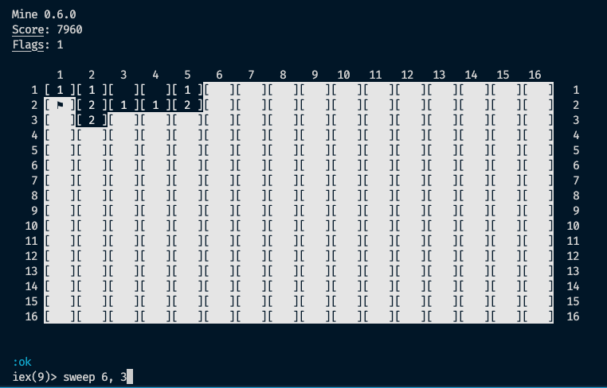

# Mine

> **Warning**
> This branch was created to illustrate the content for the book: [Elixir/OTP](https://altenwald.com/book/elixir-otp).

Mine Sweeper typical game but it uses the terminal and it's developed using Elixir.

If you love this content and want we can generate more, you can support us:

[](https://www.paypal.com/donate/?hosted_button_id=XK6Z5XATN77L2)

## Getting started

You only need to clone this repository and compile it. Ensure you have installed Elixir 1.18 or later. The deployment build uses Elixir 1.20.4 and Erlang/OTP 29 on Debian 13.

```
git clone https://github.com/altenwald/mine.git
cd mine
iex -S mix
```

Once you are inside the Elixir shell you can use the functions inside of the `Mine` module to interact with the game. The game should be running, so it's not needed to start it, but if you want, you can restart it:

```elixir
restart
```

To discover a cell use:

```elixir
sweep 1, 1
```

You have to pass the X and Y coords. When you find or think you have a flag you can mark it as:

```elixir
flag 1, 2
```

You can see here an example:

[](screenshot.png)

You can open an issue, pull a request or send us a comment when you want.

Enjoy!

## Web server and database

Run `mix deps.get` and `mix run --no-halt` to start the browser game at
http://localhost:4001. Bandit serves the Plug router and `/websession` WebSocket endpoint.
SQLite data is stored in `data/mine_dev.db` by default. Migrations run before the HTTP
listener starts and import the production score snapshot once into a new database.

`mix check --no-retry` runs the quality gate, including Dialyzer and tests with a
minimum coverage of 90%. Tests use a separate SQLite database and a free HTTP port.

## Native release

Build with `MIX_ENV=prod mix release`. Set `DATABASE_PATH` to an absolute path outside
the release directory and run `_build/prod/rel/mine/bin/mine start`. `PORT` overrides
the HTTP port; `TRUSTED_PROXIES` is a comma-separated list of proxy addresses allowed
to supply `X-Forwarded-For`.

`dymploy.yaml` prepares a Debian 13 release for the `rowan-mine` target, runs the full
gate, and checks the packaged SQLite driver and score import before deploying.
The target must be provisioned before enabling deployment. Build caches include Mix,
Hex and PLTs; `DIALYZER_PLT_DIR` selects the persistent PLT directory, with architecture
and Erlang/Elixir version separation. Without it, local Dialyxir defaults are preserved.
